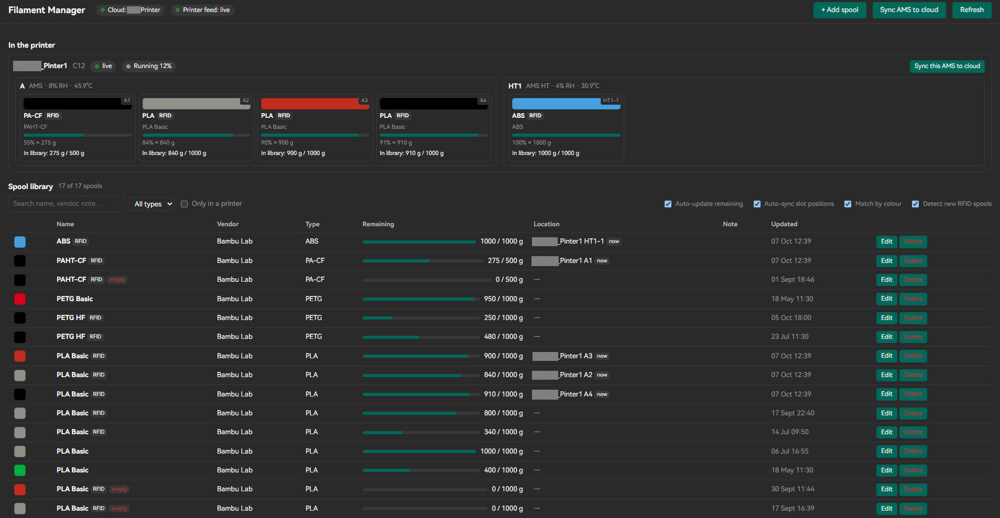

# Bambu Filament Manager



Bambu Lab's Filament Manager inside OrcaSlicer. It adds a Filament Manager
tab that shows the spool library from your Bambu account, the same one
Bambu Studio and the Handy app use, and what is loaded in your AMS right now.

- Browse, search, add, edit and delete spools in your cloud library, with
  presets from Bambu's filament catalogue or your own third-party entries.
- See every AMS slot live: filament, colour, remaining estimate, and which
  library spool it is.
- Remaining weight and slot positions are synced to the cloud the way Bambu
  Studio does it, so Handy and Studio stay in step.
- New official Bambu spools are detected when you load them. You get a
  notification and a card asking whether to add the spool or link it to one
  already in your library.
- after every slice it checks if the ams has enough filament for the plate,
  so you know before you hit print if a spool is gonna run out.

Requirements:

- The Open Bambu Networking plugin, signed in to your Bambu account. This
  plugin reuses that login and never asks for your password or stores one.
- A printer connected in the Device tab for the live AMS view. The cloud
  library works without one.
- On stock OrcaSlicer, set Preferences > Log Level to info. Live AMS data is
  read from OrcaSlicer's own log because the plugin API has no printer
  access. Builds that expose the printer state to plugins do not need this.

It does not change filament settings on the printer; that stays with
OrcaSlicer's Device tab. The Bambu cloud API it uses is unofficial and may
change.

## Install

One file: `bambu_filament_manager_any.py`. Either subscribe to it on the
Orca Cloud plugin hub, or use Plugins > **Install local plugin** and pick
the file. A "Filament Manager" tab appears next to Prepare / Preview /
Device.

The first cloud call asks for permission to make an HTTP request to
`api.bambulab.com`. Later launches ask once more on the first cloud call of
the session. Everything else is silent: the log and the OBN session file
live inside OrcaSlicer's data folder, which plugins may read.

## filament check

slice a plate and you get a notification like "enough in Workshop P1S for
this plate (23 g)" or "PLA Basic needs 123 g, A1 has ~80 g left". the "last
slice" card in the tab shows each filament on the plate, how much it needs,
which slot matches and whats left in it. "check again" reruns it against
the ams right now, handy after swapping a spool.

to turn it on: process settings > others > slicing pipeline plugin > tick
"Filament check". orca only runs these steps if the process preset names
them so you have to tick it once per process preset you use, it saves with
the preset. the step just reads the `; filament used [g]` and filament
id/colour comments out of the gcode and hands the numbers to the tab, the
compare and the notification happen there. "notify after each slice" in
the tab turns the popup off but keeps the card.

how it matches: a tray counts if its the same filament id and colour, if
not then same type and colour. remaining comes from the linked library
spool if theres one, otherwise the ams estimate, which is rough (5-10%
steps). non rfid trays with no library link have no estimate so they show
as unknown. if one spool is short but the matching spools together arent,
it tells you that, cos the ams can carry on with a backup spool of the same
filament.

## What it uses from Open Bambu Networking

It uses very little of it directly. The dependency is mostly indirect.

Used directly, by reading files OBN writes:

- `obn.auth.json` in Orca's data folder. This is the whole cloud
  dependency. It holds the Bambu account session that OBN's networking
  library saves after you log in: access token, refresh token, region, user
  name. The plugin reads the token from it for every cloud call and shows
  the user name in the header. It never writes the file and never does its
  own login, so when OBN refreshes the token the plugin just picks up the
  new one.
- `obn.state.json`, for the serial of the printer currently selected in
  Orca, used only to put that printer first in the list. Builds with host
  device bindings supply this instead.
- `obn_cloud_ca.pem`, only as a fallback certificate bundle if the system
  certificate store cannot verify api.bambulab.com. Normally unused.

Used indirectly:

- The printer connection itself. OBN's `bambu_networking.dll` is what
  connects Orca to the printer over MQTT. Everything the plugin knows about
  the AMS comes from the status messages that connection delivers to Orca,
  which the plugin then reads from Orca's log or from the host bindings.
  Without a working network plugin there is no printer data at all.

Not used:

- None of OBN's Python code, its tab, or its own settings.
- None of the filament-spool functions compiled into the DLL. They exist
  there because Bambu Studio calls them, but a Python plugin cannot reach
  the running agent, so this plugin makes the same HTTPS calls itself.

So the plugin does not technically need OBN as such. It needs two things
OBN happens to provide: a saved Bambu Cloud session in a readable file, and
a live printer connection. Bambu's stock network plugin stores its session
in `BambuNetworkEngine.conf`, which Orca's plugin sandbox refuses to let
plugins read, so with the stock plugin the cloud side would not work.

## Printer data on stock OrcaSlicer

OrcaSlicer's plugin API has no access to the printer, but at Log Level
`info` (or `debug` / `trace`) OrcaSlicer writes every message it receives
from the printer into its own log. The plugin tails
`%APPDATA%\OrcaSlicer\log\debug_*.log.0` to get the AMS trays. At
`warning` (the default) the "Printer feed" pill stays red and only the
cloud library works.

Cost: the printer reports about once a second, so the log grows by a few
tens of MB per hour. OrcaSlicer rotates it at 100 MB and starts a new file
each launch.

### Custom OrcaSlicer builds

The `better-rotate` branch of RubberDingyRapids/OrcaSlicer (commit
`d1519bde`, source `src/slic3r/plugin/host/PluginHostDevices.cpp`) exposes
`orca.host.devices()`, `selected_device_id()`, `device_status(dev_id)`
(merged full-state JSON of the last printer push) and
`device_status_seq(dev_id)`. When those exist the plugin uses them instead
of the log and the log level no longer matters. Detection is automatic; the
"Printer feed" pill's tooltip says which source is in use.

## How it is built

- `orca.pages` capability: a tab holding an HTML page with the
  `window.orca.postMessage` / `onMessage` bridge. All cloud calls run on
  the UI thread inside `on_message`, where the permission prompt is safe.
  The page drives periodic work with timers (state every 3 s, cloud sync
  every 60 s).
- `LogTailer` thread follows the newest `debug_*.log*`, parses
  `parse_json: dev_id=…, origin playload={…}` lines and merges the
  `print.ams` / `vt_tray` / `info.get_version` fields per printer.
- `CloudClient` talks to `design-user-service/my/filament/v2` (list,
  create, update, batch delete), `filament/config` (catalogue),
  `.../ams/sync`, `.../slot-mappings/sync` and `.../soft-match/pending`,
  plus `iot-service/api/user/bind` for printer names. Endpoint shapes come
  from the open-bamboo-networking research notes (MITM of Bambu's own
  plugin) and Bambu Studio's `fila_manager` sources.
- Trays are matched to spools by `tray_uuid` == cloud `RFID` (Studio's
  rule). Non-RFID trays optionally match by filament id + colour.
- Remaining weight is pushed from the AMS estimate at most every 10 minutes
  per spool while printing (Studio's throttle). Slot positions are sent one
  request per AMS unit, because the cloud keys slots by AMS serial plus slot
  number; the serial comes from the printer's version reply or, failing
  that, from a cloud spool record mounted in that unit.
- New-spool detection mirrors `wgtFilaManagerSync::check_and_register_new_rfid_spools`
  and `StatusPanel::open_new_official_filament_hint`: official chip only
  (`tag_uid` bytes 12..13 == "01"), AMS Lite skipped, one `ams/sync` per
  spool, then `soft-match/pending` to see whether the cloud parked it;
  decisions go to the same endpoint as `accept`, `link_other` or
  `create_new`. Verified live on 2026-10-05 with a throwaway RFID: the
  cloud created the spool at once (`createdRFIDs`) with the slot position,
  and the queue stayed empty; the parked path is covered by tests only.

## Development

```
python -m unittest tests.test_offline -v     # no network, no OrcaSlicer
python dev/preview.py                        # dev/preview.html with mock data
python dev/check_cloud.py                    # read-only GETs against your account
```

Logs from the plugin go to OrcaSlicer's stderr with a `[filament_manager]`
prefix and to `%APPDATA%\OrcaSlicer\log\python_*.log`.

## Known limits

- the filament check compares against the whole ams, not the slot mapping
  you pick in the print dialog, cos the plugin only sees the slice.

- Clearing a slot position in the cloud needs the AMS serial. If neither
  the printer's version reply nor a cloud spool record has supplied it,
  clearing is skipped for that unit.
- Remaining-weight pushes need the spool's total net weight in the cloud;
  spools with 0 g total are skipped, as in Studio.
- A badge on the tab itself is not possible: OrcaSlicer reads a plugin's
  tab icon once. The notification and the in-tab cards stand in for it.
- The cloud API is reverse engineered and may change.
